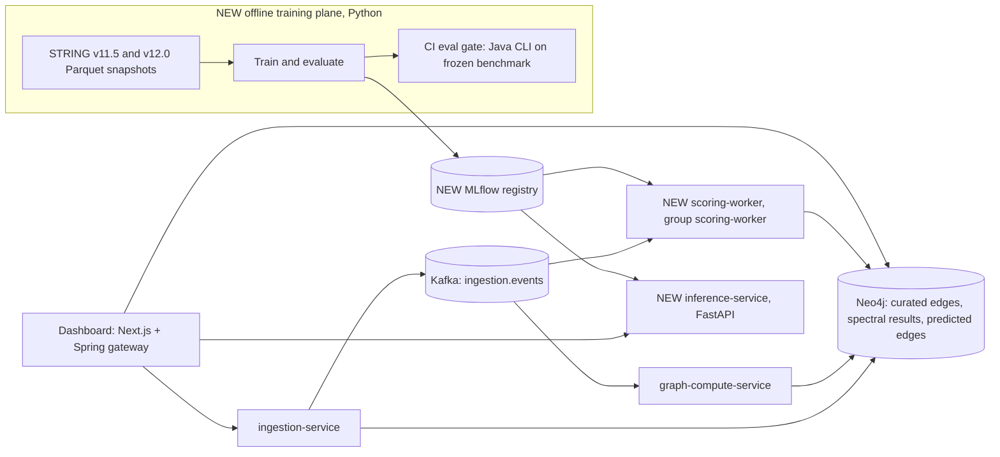

# ProteinLens v2: From Spectral Pipeline to MLE System

Oct 30, 2026 · @Rohan

## Overview

ProteinLens v2 adds a Python training plane and a model-serving path to the existing Java/Kafka/Neo4j pipeline, so the project demonstrates the full loop: versioned data, evaluated models, gated releases, and monitored predictions in production. The existing services stay as the backbone; new pieces plug into the same patterns they already use.

### Where the code stands today

| Area | Current state | Problem for an MLE story |
| --- | --- | --- |
| Learning | No training, no learned model | Nothing to evaluate, version, or serve |
| Evaluation | No eval code; the 70% cluster-validation claim is not reproducible from the repo | The first thing an interviewer will look for |
| Centrality | Power iteration on D^-1/2 A D^-1/2 | Converges to D^1/2 1, so the score is sqrt(weighted degree), not eigenvector centrality |
| k\* selection | Argmax gap over all n-1 eigenvalue gaps | Can pick k near n, or k=1 on disconnected subgraphs |
| Scale | Dense n x n eigendecomposition | O(n^3) time; about 3 GB for the 19.5k-protein human proteome before decomposition |
| Reliability | Worker rethrows "to trigger Kafka retry/DLQ if configured", but no DLQ is configured | Poison messages retry forever |
| Hygiene | 53 committed `target/` files, no `.gitignore`, one 80-line test, unused `Neo4jWriterService` | Reads as unfinished |

### What v2 adds, by layer

- **Data:** STRING versions snapshotted to Parquet, keyed by version and content hash. Benchmarks are frozen files with checksums.
- **Compute (Java):** fixed centrality and k\*, a pluggable `SpectralBackend`, a CLI profile so CI can run the exact production code on a benchmark graph, and a DLQ.
- **ML plane (Python, new `ml/` package):** complex-detection and link-prediction eval harnesses, feature code shared by training and serving, a model ladder from heuristics to GraphSAGE, and MLflow tracking and registry.
- **Serving (new):** a Python `scoring-worker` in its own Kafka consumer group on `ingestion.events`, plus a FastAPI `inference-service`. Predictions land in Neo4j as `PREDICTED_INTERACTS` edges stamped with model and feature versions.
- **Gateway and UI:** a `PredictionQueryController` that mirrors `GraphQueryController`, and dashed predicted edges with a probability slider in the dashboard.
- **Ops:** Helm templates for the new services, KEDA autoscaling on consumer lag, Prometheus metrics for latency and score drift, and a CI eval gate.

The diagram below shows how the new components attach to the current flow.



One Kafka publish now feeds two consumer groups: graph compute writes spectral results and the scoring worker writes predicted edges, both into Neo4j. Models flow one way, from the offline plane through the MLflow registry into the two serving processes.

## Step 1: Make the current system correct and measurable (week 1)

Step 1 ends with a reproducible complex-detection score from CI, produced by the same Java code that runs in production. That number replaces the current 70% claim.

### 1.1 Cleanup

- [ ] Add a root `.gitignore` (`target/`, `node_modules/`, `.next/`, `.venv/`, `mlruns/`) and run `git rm -r --cached '*/target'`
- [ ] Delete `Neo4jWriterService`; `SpectralResultWriter` already does bulk `UNWIND` writes
- [ ] Pick one score scale. The README says both 0 to 1000 and normalized to \[0, 1\]; check what `Neo4jIngestionService` stores and document it once

### 1.2 Return the raw adjacency alongside the Laplacian

The fixes below need A itself, but `NormalizedLaplacianService` scales `a.nz_values` in place, so A is destroyed on the way to L. Return a small record instead and copy before scaling. This keeps the service's current single-pass CSC style.

```java
// model/GraphMatrices.java
public record GraphMatrices(DMatrixSparseCSC adjacency, double[] degree, DMatrixSparseCSC laplacian) {}

// NormalizedLaplacianService.compute(...), after the degree loop
DMatrixSparseCSC aNorm = a.copy();          // keep A intact
for (int col = 0; col < n; col++) {
    for (int ptr = aNorm.col_idx[col]; ptr < aNorm.col_idx[col + 1]; ptr++) {
        aNorm.nz_values[ptr] *= dInvSqrt[aNorm.nz_rows[ptr]] * dInvSqrt[col];
    }
}
// ... identity and CommonOps_DSCC.add exactly as today, using aNorm ...
return new GraphMatrices(a, d, l);
```

`SpectralAnalyzerService.analyze` then takes `GraphMatrices`, and `GraphComputeWorker` passes it through. No other caller changes.

### 1.3 Replace the centrality with weighted PageRank

The dominant eigenvector of D^-1/2 A D^-1/2 is D^1/2 1, so today's power iteration always returns sqrt(weighted degree). Eigenvector centrality on A is also ill-posed on disconnected or bipartite subgraphs, which STRING subgraphs often are. Weighted PageRank converges on any graph and runs on the sparse matrix in O(nnz) per iteration, replacing the current O(n^2) dense loop.

```java
/** Weighted PageRank on symmetric A (CSC). Column j of A equals row j, so a column sweep is a row sweep. */
static double[] pageRank(DMatrixSparseCSC a, double[] degree, double damping, double tol, int maxIter, int[] itersOut) {
    int n = a.numRows;
    double[] r = new double[n], next = new double[n];
    Arrays.fill(r, 1.0 / n);
    for (int iter = 1; iter <= maxIter; iter++) {
        double dangling = 0.0;
        for (int i = 0; i < n; i++) if (degree[i] == 0.0) dangling += r[i];
        Arrays.fill(next, (1.0 - damping) / n + damping * dangling / n);
        for (int col = 0; col < n; col++) {
            if (degree[col] == 0.0) continue;
            double share = damping * r[col] / degree[col];
            for (int p = a.col_idx[col]; p < a.col_idx[col + 1]; p++) {
                next[a.nz_rows[p]] += a.nz_values[p] * share;
            }
        }
        double delta = 0.0;
        for (int i = 0; i < n; i++) delta += Math.abs(next[i] - r[i]);
        double[] t = r; r = next; next = t;
        if (delta < tol) { itersOut[0] = iter; return r; }
    }
    itersOut[0] = maxIter;
    return r;
}
```

Keep `convergedIn` and the \[0, 1\] max-normalization so the dashboard contract is unchanged. Add a unit test on a star graph (hub must rank first) and a two-component graph (no NaN, scores sum to 1). Write the sqrt(degree) finding up in the README; it is a good interview story.

### 1.4 Bound the eigengap search

Search only between the number of connected components and a configured `kMax`. Eigenvalues are 0-indexed and ascending, so the gap after k clusters is `eig[k] - eig[k - 1]`.

```java
static int chooseK(double[] eig, int kMax) {
    int components = 0;
    while (components < eig.length && eig[components] < 1e-8) components++;
    int lo = Math.max(1, components), hi = Math.min(kMax, eig.length - 1);
    if (lo >= hi) return lo;
    int best = lo; double bestGap = -1.0;
    for (int k = lo; k <= hi; k++) {
        double gap = eig[k] - eig[k - 1];
        if (gap > bestGap) { bestGap = gap; best = k; }
    }
    return best;
}
```

Add an optional `k` override on the job DTO (`ComputeJobDto.k`, null means auto) so the eval harness can sweep k.

### 1.5 Make the eigensolver pluggable

You only use the bottom k\* eigenpairs, but compute all n. Put the current EJML code behind an interface and fail fast above a size limit instead of running out of memory.

```java
public interface SpectralBackend {
    /** Smallest k eigenpairs of L_sym, eigenvalues ascending, eigenvectors as columns of an n x k matrix. */
    EigenPairs smallest(DMatrixSparseCSC laplacian, int k);
}

@Component
@ConditionalOnProperty(name = "spectral.backend", havingValue = "dense", matchIfMissing = true)
class DenseEjmlBackend implements SpectralBackend {
    @Value("${spectral.dense-max-n:3000}") int maxN;
    public EigenPairs smallest(DMatrixSparseCSC l, int k) {
        if (l.numRows > maxN) throw new GraphTooLargeException(l.numRows, maxN); // goes to the DLQ (1.7)
        // current DecompositionFactory_DDRM.eig code, truncated to k pairs
    }
}
```

Full-proteome embeddings move to the Python plane, where `scipy.sparse.linalg.eigsh` does Lanczos. Ask it for the largest eigenvalues of A\_norm (`which="LA"`) rather than the smallest of L; since L = I - A\_norm they are the same eigenvectors, and Lanczos converges much faster at the top of the spectrum.

```python
# ml/proteinlens_ml/features/spectral.py
def spectral_embedding(a: sp.csr_matrix, k: int, seed: int = 42) -> np.ndarray:
    d = np.asarray(a.sum(axis=1)).ravel()
    d_inv_sqrt = np.where(d > 0, 1.0 / np.sqrt(d), 0.0)
    a_norm = sp.diags(d_inv_sqrt) @ a @ sp.diags(d_inv_sqrt)
    v0 = np.random.default_rng(seed).standard_normal(a.shape[0])
    vals, vecs = eigsh(a_norm, k=k, which="LA", v0=v0)
    vecs = vecs[:, np.argsort(-vals)]                 # ascending eigenvalues of L
    return vecs / np.maximum(np.linalg.norm(vecs, axis=1, keepdims=True), 1e-12)  # NJW row-normalize
```

### 1.6 A CLI profile so CI runs the production code

Add a `cli` Spring profile that reads an edge list and writes cluster assignments, with Kafka and Neo4j auto-configuration excluded. Mark `IngestionEventConsumer` and `SubgraphRepository` `@Profile("!cli")`.

```java
@Component
@Profile("cli")
@RequiredArgsConstructor
class SpectralCli implements CommandLineRunner {
    private final NormalizedLaplacianService laplacian;
    private final SpectralAnalyzerService analyzer;

    public void run(String... args) throws Exception {
        ProteinSubgraph g = EdgeListReader.read(Path.of(args[0]));       // TSV: source, target, score
        Integer k = args.length > 2 ? Integer.valueOf(args[2]) : null;
        SpectralResult r = analyzer.analyze(laplacian.compute(g), k);
        ClusterCsvWriter.write(Path.of(args[1]), g.nodeIds(), r);          // stringId, clusterId, centrality
    }
}
```

```yaml
# application-cli.yml
spring:
  main.web-application-type: none
  autoconfigure.exclude:
    - org.springframework.boot.autoconfigure.kafka.KafkaAutoConfiguration
    - org.springframework.boot.autoconfigure.neo4j.Neo4jAutoConfiguration
    - org.springframework.boot.autoconfigure.data.neo4j.Neo4jDataAutoConfiguration
```

### 1.7 Configure the DLQ the worker already assumes

`GraphComputeWorker` rethrows so Kafka can retry, but `KafkaConfig` sets no error handler. Add one to the existing container factory.

```java
@Bean
DefaultErrorHandler errorHandler(KafkaTemplate<String, Object> template) {
    var recoverer = new DeadLetterPublishingRecoverer(template,
        (rec, ex) -> new TopicPartition(rec.topic() + ".dlq", rec.partition()));
    var handler = new DefaultErrorHandler(recoverer, new FixedBackOff(2_000L, 3));
    handler.addNotRetryableExceptions(GraphTooLargeException.class, IllegalArgumentException.class);
    return handler;
}
// in kafkaListenerContainerFactory(): factory.setCommonErrorHandler(errorHandler);
```

The compute service needs a producer factory for this; copy the one from `ingestion-service/config/KafkaConfig`. Create `ingestion.events.dlq` with 3 partitions so partition numbers line up.

### 1.8 Complex-detection eval harness

Score predicted clusters against curated human complexes ([CORUM](https://mips.helmholtz-muenchen.de/corum/) and [Complex Portal](https://www.ebi.ac.uk/complexportal/)), mapped from UniProt to STRING IDs with STRING's `9606.protein.aliases` file. Use the standard metrics: a cluster matches a complex when overlap score ω = |P ∩ C|^2 / (|P| |C|) is at least 0.25 (Bader and Hogue, 2003), plus maximum matching ratio, a one-to-one assignment score (Nepusz et al., 2012).

```python
# ml/proteinlens_ml/eval/complexes.py
import numpy as np
from scipy.optimize import linear_sum_assignment

def overlap(p: frozenset[str], c: frozenset[str]) -> float:
    i = len(p & c)
    return i * i / (len(p) * len(c))

def complex_metrics(pred: list[frozenset[str]], ref: list[frozenset[str]], omega: float = 0.25) -> dict[str, float]:
    pred = [p for p in pred if len(p) >= 3]
    w = np.array([[overlap(p, c) for p in pred] for c in ref])      # ref x pred
    hit = w >= omega
    precision = float(hit.any(axis=0).mean())
    recall = float(hit.any(axis=1).mean())
    f1 = 2 * precision * recall / (precision + recall) if precision + recall else 0.0
    rows, cols = linear_sum_assignment(w, maximize=True)
    mmr = float(w[rows, cols].sum() / len(ref))
    return {"precision": precision, "recall": recall, "f1": f1, "mmr": mmr, "n_pred": len(pred)}
```

Filter reference complexes to those with at least 3 members present in the benchmark graph, and report that count with every result. Expect eigengap-chosen k to score poorly: complexes have 3 to 20 members, while the eigengap tends to find a handful of large clusters. That is a finding to report, and the reason for the k sweep.

### 1.9 Baselines and results table

Run every method on the same frozen benchmark: high-confidence human physical edges (combined score at least 700) induced on CORUM proteins and their neighbors, committed as `benchmarks/human_physical_corum.tsv.gz` with its checksum in `benchmarks/SHA256SUMS`.

| Method | Implementation | Params | Precision | Recall | F1 | MMR |
| --- | --- | --- | --- | --- | --- | --- |
| Spectral, eigengap k | Java CLI | kMax=20 |  |  |  |  |
| Spectral, k sweep | Java CLI | best k on a held-out half of complexes |  |  |  |  |
| Louvain | networkx | resolution sweep |  |  |  |  |
| Leiden | leidenalg | resolution sweep |  |  |  |  |
| MCL | markov\_clustering | inflation 1.8 to 3.0 |  |  |  |  |

Tune hyperparameters on half the reference complexes and report on the other half; tuning on the full reference set inflates every row.

### 1.10 CI eval gate

A pull request that drops F1 or MMR by more than 0.02 against the committed baseline fails.

```yaml
# .github/workflows/eval-gate.yml
name: eval-gate
on: [pull_request]
jobs:
  complexes:
    runs-on: ubuntu-latest
    steps:
      - uses: actions/checkout@v4
      - uses: actions/setup-java@v4
        with: { distribution: temurin, java-version: '21' }
      - uses: astral-sh/setup-uv@v5
      - run: mvn -q -f graph-compute-service/pom.xml package -DskipTests
      - run: sha256sum -c benchmarks/SHA256SUMS
      - run: >
          java -jar graph-compute-service/target/graph-compute-service-*.jar
          --spring.profiles.active=cli benchmarks/human_physical_corum.tsv.gz out/clusters.csv
      - run: >
          uv run --project ml pl-eval complexes --clusters out/clusters.csv
          --reference benchmarks/corum_9606.json --baseline benchmarks/metrics_baseline.json --max-drop 0.02
```

The `CommandLineRunner` receives every argument, including `--spring.profiles.active`; filter out arguments that start with `--` in `SpectralCli`, or read them through `ApplicationArguments.getNonOptionArgs()`.

## Step 2: A real learning task with honest evaluation (weeks 2 and 3)

Step 2 trains models to predict which human physical interactions STRING v12.0 adds that v11.5 lacked, scored against hard negatives, with every run tracked in MLflow. The temporal split is the design choice to defend in interviews: it mimics deployment, where the model scores pairs nobody has confirmed yet.

### 2.1 Versioned data snapshots

Download `9606.protein.physical.links.detailed.v11.5.txt.gz` and the v12.0 equivalent from [STRING downloads](https://string-db.org/cgi/download), plus `9606.protein.sequences.v12.0.fa.gz`. Check the column headers before relying on the names below. Normalize each file to canonical undirected pairs and write Parquet keyed by version and content hash, so every model can name the exact data it saw.

```python
# ml/proteinlens_ml/data/snapshot.py
def load_physical(version: str, raw: Path) -> pl.DataFrame:
    df = pl.read_csv(raw / f"9606.protein.physical.links.detailed.{version}.txt.gz", separator=" ")
    lo, hi = pl.col("protein1"), pl.col("protein2")
    return (df.with_columns(a=pl.when(lo < hi).then(lo).otherwise(hi),
                            b=pl.when(lo < hi).then(hi).otherwise(lo))
              .unique(["a", "b"])                      # STRING lists both directions
              .select("a", "b", "combined_score"))

def write_snapshot(df: pl.DataFrame, version: str, out: Path) -> str:
    digest = hashlib.sha256(df.sort(["a", "b"]).write_ipc(None).getvalue()).hexdigest()[:12]
    df.write_parquet(out / f"physical_{version}_{digest}.parquet")
    return digest
```

This is the same canonical-pair rule as `NormalizedLaplacianService` (keep i < j), applied once at the data layer. Check how many protein IDs differ between v11.5 and v12.0; drop proteins missing from either version and report the count.

### 2.2 Temporal split

A test positive is a high-confidence v12.0 edge with no v11.5 evidence at all. Requiring absence, not just a score below 700, keeps out pairs that merely crossed the threshold, which a model could predict from their old score.

```python
# ml/proteinlens_ml/data/split.py
@dataclass(frozen=True)
class Split:
    nodes: list[str]
    train: pl.DataFrame      # message-passing graph and training positives
    val_pos: pl.DataFrame    # random 10% of high-confidence v11.5 edges, removed from train
    test_pos: pl.DataFrame   # new in v12.0
    id: str                  # hash of the inputs and parameters

def endpoints(df: pl.DataFrame) -> set[str]:
    return set(df["a"]) | set(df["b"])

def temporal_split(old, new, min_score=700, val_frac=0.1, seed=42) -> Split:
    nodes = sorted(endpoints(old) & endpoints(new))
    keep = lambda df: df.filter(pl.col("a").is_in(nodes) & pl.col("b").is_in(nodes))
    old, new = keep(old), keep(new)
    hi_old = old.filter(pl.col("combined_score") >= min_score).sample(fraction=1.0, shuffle=True, seed=seed)
    n_val = int(val_frac * hi_old.height)
    test_pos = new.filter(pl.col("combined_score") >= min_score).join(old, on=["a", "b"], how="anti")
    return Split(nodes, hi_old[n_val:], hi_old[:n_val], test_pos, id=split_hash(old, new, min_score, val_frac, seed))
```

STRING introduced the physical subnetwork in v11.5, so there is no earlier physical version for a second temporal split. Validation therefore uses held-out v11.5 edges, which is easier than the test; say so when reporting.

### 2.3 Hard negatives

Random pairs are trivially separable, because most proteins have low degree and positives skew toward hubs. Report every metric separately for two negative sets, at 10 negatives per positive.

- **Degree-matched:** keep one endpoint, replace the other with a protein from the same log2-degree bin in the train graph. This removes the "both ends are hubs" shortcut.
- **Distance-2:** pairs that share at least one neighbor in the train graph. Common-neighbor heuristics look strongest here and fail most, so this set separates learned models from counting.

```python
# ml/proteinlens_ml/data/negatives.py
def degree_bin(v: str, adj: dict[str, set[str]]) -> int:
    return int(np.log2(len(adj[v]) + 1))

def degree_matched(pos, adj, excluded: set[tuple[str, str]], ratio: int, rng) -> list[tuple[str, str]]:
    bins: dict[int, list[str]] = defaultdict(list)
    for v in adj:
        bins[degree_bin(v, adj)].append(v)
    out = []
    for a, b in pos.select("a", "b").iter_rows():
        pool, got = bins[degree_bin(b, adj)], 0
        while got < ratio:                       # add a max-tries cap for tiny bins
            c = pool[rng.integers(len(pool))]
            pair = (min(a, c), max(a, c))
            if c != a and pair not in excluded:
                out.append(pair)
                got += 1
    return out

def distance_two(pos, adj, excluded, ratio: int, rng) -> list[tuple[str, str]]:
    out = []
    for a, _ in pos.select("a", "b").iter_rows():
        cands = list({c for n in adj[a] for c in adj[n]} - adj[a] - {a})
        rng.shuffle(cands)
        out += [p for p in ((min(a, c), max(a, c)) for c in cands) if p not in excluded][:ratio]
    return out
```

`excluded` is every pair present in either version at any score. Absence from STRING is not proof of non-interaction; note it as a limitation, and optionally report on [Negatome 2.0](https://mips.helmholtz-muenchen.de/proj/ppi/negatome/) curated negatives as a sanity check.

Metrics: AUPRC per negative set, and Hits@50 in the OGB style (the share of positives scoring above the 50th-highest negative).

### 2.4 Leakage guard

These rules go in code as assertions, not just in the README.

- No STRING edge scores as features. Negatives have no score, so any score feature teaches the model "has a score means positive".
- Every graph feature (degree, spectral embedding, node2vec, message passing) is computed on `split.train` only. Val and test edges never enter the message-passing graph.
- Feature scaling is fit on training nodes and edges only.
- Inside GraphSAGE training, supervision edges are disjoint from message edges each epoch (PyG's `RandomLinkSplit(disjoint_train_ratio=0.3)`), or the model learns to recognize edges it can see.
- The test set is scored once per model family, after selection on validation.

```python
# ml/tests/test_leakage.py
def test_eval_edges_absent_from_message_graph(split):
    mp = set(zip(split.train["a"], split.train["b"]))
    for df in (split.val_pos, split.test_pos):
        assert mp.isdisjoint(zip(df["a"], df["b"]))
```

### 2.5 Node features from ESM-2

Embed every protein sequence once with ESM-2 and cache it. Sequence embeddings contain no graph information, so they are leakage-free, and they let the model score a protein with no known interactions. `esm2_t33_650M_UR50D` gives 1280-dimensional mean-pooled vectors and is practical on a free Colab GPU for about 19.5k sequences; `esm2_t12_35M_UR50D` (480 dimensions) runs on a laptop CPU. Truncate or chunk sequences longer than the 1022-token context and record which you chose.

```python
# ml/proteinlens_ml/features/esm.py
@torch.inference_mode()
def embed(seqs: dict[str, str], name="facebook/esm2_t33_650M_UR50D", batch=8) -> pl.DataFrame:
    tok, model = AutoTokenizer.from_pretrained(name), AutoModel.from_pretrained(name).eval().to(DEVICE)
    rows = []
    for ids in batched(sorted(seqs), batch):
        enc = tok([seqs[i] for i in ids], return_tensors="pt", padding=True, truncation=True, max_length=1024).to(DEVICE)
        h = model(**enc).last_hidden_state
        mask = enc["attention_mask"].unsqueeze(-1)
        pooled = (h * mask).sum(1) / mask.sum(1)              # mean over residues, includes BOS/EOS
        rows += [(i, sha1(seqs[i]), v.cpu().numpy()) for i, v in zip(ids, pooled)]
    return pl.DataFrame(rows, schema=["string_id", "seq_sha1", "emb"], orient="row")
```

### 2.6 Model ladder

Each rung answers a question about the one below it. Fill the table from MLflow, not by hand.

| Model | Features | Question it answers | Inductive | AUPRC, degree-matched | AUPRC, distance-2 | Hits@50 |
| --- | --- | --- | --- | --- | --- | --- |
| Adamic-Adar, resource allocation, common neighbors | Train graph | How far does counting get? | No |  |  |  |
| ESM-2 pair MLP | Sequence only | Does the graph add anything? | Yes |  |  |  |
| Spectral embedding + logistic regression | Step 1 embedding, Hadamard product | Is the existing math useful as features? | No |  |  |  |
| node2vec + logistic regression | Random-walk embedding | Standard transductive baseline | No |  |  |  |
| GraphSAGE + MLP decoder | ESM-2 nodes, train graph | Graph and sequence together | Yes |  |  |  |

GraphSAGE is the served model because it is inductive: a protein ingested tomorrow gets an embedding from its sequence and neighbors without retraining. Spectral and node2vec embeddings need a full recompute for any new node.

```python
# ml/proteinlens_ml/models/sage.py
class SageLinkPredictor(nn.Module):
    def __init__(self, in_dim: int, hidden: int = 256, layers: int = 2, dropout: float = 0.2):
        super().__init__()
        self.convs = nn.ModuleList(SAGEConv(in_dim if i == 0 else hidden, hidden) for i in range(layers))
        self.dropout = dropout
        self.decoder = nn.Sequential(nn.Linear(hidden, hidden), nn.ReLU(), nn.Linear(hidden, 1))

    def encode(self, x: Tensor, edge_index: Tensor) -> Tensor:
        for i, conv in enumerate(self.convs):
            x = conv(x, edge_index)
            if i < len(self.convs) - 1:
                x = F.dropout(F.relu(x), self.dropout, self.training)
        return x

    def forward(self, x: Tensor, edge_index: Tensor, pairs: Tensor) -> Tensor:
        z = self.encode(x, edge_index)
        return self.decoder(z[pairs[0]] * z[pairs[1]]).squeeze(-1)   # logits
```

The whole human graph fits in memory, so train full-batch with `BCEWithLogitsLoss`, drawing each epoch's negatives from a mix of random, degree-matched and distance-2 pairs. Select the checkpoint on validation AUPRC with distance-2 negatives.

### 2.7 Experiment tracking and the registry

Every run logs its data identity, so a registered model can always be traced to the exact split and feature code.

```python
# ml/proteinlens_ml/train.py
with mlflow.start_run(run_name=f"{cfg.model}-{split.id}"):
    mlflow.log_params(asdict(cfg))
    mlflow.set_tags({"string_train": "v11.5", "string_test": "v12.0", "split_id": split.id,
                     "feature_version": FEATURE_VERSION, "git_sha": git_sha()})
    model = fit(cfg, split, features)
    for neg_kind, m in evaluate(model, split, features).items():
        mlflow.log_metrics({f"{neg_kind}.{k}": v for k, v in m.items()})
    mlflow.pytorch.log_model(model, "model", registered_model_name="ppi-linkpred")
```

Promotion uses registry aliases. A script sets the new version as `challenger`; it becomes `champion` only if distance-2 AUPRC beats the current champion by at least 0.01 and degree-matched AUPRC drops by no more than 0.01. Run it as a manual GitHub Actions workflow so promotions leave an audit trail.

```python
client = MlflowClient()
client.set_registered_model_alias("ppi-linkpred", "challenger", new_version)
if passes_promotion_rule(client, "ppi-linkpred"):
    client.set_registered_model_alias("ppi-linkpred", "champion", new_version)
```

For local work, MLflow with a SQLite backend and a local artifact folder is enough. In the cluster it runs from the Helm chart (Step 3) with Postgres and an S3 bucket.

## Step 3: Serve, observe, and deploy the model (weeks 4 and 5)

Step 3 puts the champion model behind the existing event flow: every successful ingestion is scored automatically, predictions land in Neo4j with full provenance, and latency and score drift show up in Grafana. The served model is retrained on all of v12.0 after selection, since the live STRING API that ingestion calls already serves v12.0.

### 3.1 One feature path for training and serving

The trainer and both serving processes import the same `proteinlens_ml.features` module, and a model refuses to load if its feature version does not match the code. This catches the most common production ML bug (training and serving computing features differently) at startup instead of in silent bad predictions.

```python
# ml/proteinlens_ml/features/__init__.py
FEATURE_VERSION = "f1"   # bump on ANY change to build_node_features or its inputs

def build_node_features(graph: SnapshotGraph, esm: EsmStore) -> torch.Tensor:
    x = esm.matrix(graph.node_ids)                          # (n, 1280), row order = graph.index
    return torch.from_numpy((x - esm.train_mean) / esm.train_std).float()

# ml/proteinlens_ml/serving/registry.py
def load_alias(alias: str) -> LoadedModel:
    client = MlflowClient()
    mv = client.get_model_version_by_alias("ppi-linkpred", alias)
    tags = client.get_run(mv.run_id).data.tags
    if tags["feature_version"] != FEATURE_VERSION:
        raise RuntimeError(f"model {mv.version} needs features {tags['feature_version']}, code has {FEATURE_VERSION}")
    module = mlflow.pytorch.load_model(f"models:/ppi-linkpred@{alias}").eval()
    calibrator = mlflow.sklearn.load_model(f"runs:/{mv.run_id}/calibrator")
    return LoadedModel(module, calibrator, version=mv.version, split_id=tags["split_id"])
```

ESM-2 embeddings are precomputed for every human protein in the STRING v12.0 sequence file, so the serving path never runs ESM-2. Jobs for other species are skipped with a counter, not an error, because the model was trained on human data only.

### 3.2 Batch embeddings, online decoding

GraphSAGE encodes every node once per model load, over the frozen v12.0 snapshot graph, and caches the embedding matrix. Scoring a job is then only candidate generation plus the small MLP decoder, which takes milliseconds. This is the standard split between expensive batch work and cheap online work, and it is worth explaining in interviews.

Candidates come from graph neighborhoods (2-hop non-neighbors, plus other proteins in the same job) rather than all 19.5k proteins. The decoder takes a Hadamard product through an MLP, so it is not a dot product and approximate nearest-neighbor search does not apply directly.

Train-time class balance (1 positive to 10 negatives) differs from the real rate, so raw sigmoid outputs are not probabilities. Fit an isotonic calibrator on validation scores and log it next to the model.

```python
# ml/proteinlens_ml/serving/scorer.py
class Scorer:
    def __init__(self, model: LoadedModel, graph: SnapshotGraph, x: torch.Tensor):
        self.model, self.graph = model, graph
        with torch.inference_mode():
            self.z = model.module.encode(x, graph.edge_index)      # (n, hidden), once per model load

    @torch.inference_mode()
    def score_job(self, ids: list[str], per_node: int = 200, top_k: int = 20, min_prob: float = 0.5) -> list[Prediction]:
        out: list[Prediction] = []
        known = [i for i in ids if i in self.graph.index]
        UNKNOWN_PROTEINS.inc(len(ids) - len(known))
        for a in known:
            cands = self.graph.candidates(a, others=known, limit=per_node)
            if not cands:
                continue
            ia, ib = self.graph.index[a], torch.tensor([self.graph.index[c] for c in cands])
            logits = self.model.module.decoder(self.z[ia] * self.z[ib]).squeeze(-1)
            probs = self.model.calibrator.predict(logits.numpy())
            SCORE_HIST.labels(self.model.version).observe_many(probs)   # drift input, see 3.7
            best = np.argsort(-probs)[:top_k]
            out += [Prediction(a, cands[j], float(probs[j])) for j in best if probs[j] >= min_prob]
        return out
```

`observe_many` is a small helper that loops `Histogram.observe`; `prometheus_client` has no batch method.

### 3.3 Scoring worker on the existing event

The worker subscribes to `ingestion.events` in its own consumer group, `scoring-worker`. Kafka delivers every event to each group, so graph compute and scoring run in parallel off one publish, and `ingestion-service` does not change. It mirrors `IngestionEventConsumer`: skip non-SUCCESS events, process, and route failures to a DLQ.

```python
# ml/proteinlens_ml/serving/worker.py
class IngestionEvent(BaseModel):                  # mirrors IngestionEventDto
    jobId: str
    status: Literal["SUCCESS", "PARTIAL_FAILURE", "FAILURE"]
    identifiers: list[str]
    speciesTaxonId: int | None = None
    timestamp: datetime

def run(scorer: Scorer, writer: PredictionWriter, shadow: Scorer | None) -> None:
    consumer = Consumer({"bootstrap.servers": BOOTSTRAP, "group.id": "scoring-worker",
                         "enable.auto.commit": False, "auto.offset.reset": "earliest"})
    dlq = Producer({"bootstrap.servers": BOOTSTRAP})
    consumer.subscribe(["ingestion.events"])
    while True:
        msg = consumer.poll(1.0)
        if msg is None or msg.error():
            continue
        try:
            event = IngestionEvent.model_validate_json(msg.value())
            if event.status == "SUCCESS" and event.speciesTaxonId in (None, 9606):
                with JOB_SECONDS.time():
                    preds = scorer.score_job(event.identifiers)
                    writer.write(event.jobId, scorer.model, preds)
                if shadow:
                    compare_shadow(preds, shadow.score_job(event.identifiers))   # metrics only, no writes
                E2E_SECONDS.observe((datetime.now(timezone.utc) - event.timestamp).total_seconds())
        except Exception:
            log.exception("scoring failed key=%s", msg.key())
            dlq.produce("ingestion.events.scoring-dlq", key=msg.key(), value=msg.value())
            dlq.flush()
        consumer.commit(msg)                       # after the write: at-least-once, MERGE keeps it idempotent
```

`compare_shadow` records the Jaccard overlap of champion and challenger top-k sets and the challenger's score histogram. A challenger earns promotion on live traffic only after it agrees on most confident predictions and wins offline.

### 3.4 Predictions in Neo4j, with provenance

Predictions are a separate relationship type, so no existing query can confuse them with curated edges. Each edge names the model and feature version that produced it, and re-delivery of the same event overwrites rather than duplicates.

```
(Protein)-[:PREDICTED_INTERACTS {prob, modelVersion, featureVersion, jobId, scoredAt}]->(Protein)
(ModelVersion {name, version, featureVersion, splitId, trainedOn, promotedAt})
```

```python
# ml/proteinlens_ml/serving/writer.py
WRITE_PREDICTIONS = """
MERGE (mv:ModelVersion {name: 'ppi-linkpred', version: $version})
  ON CREATE SET mv.featureVersion = $featureVersion, mv.splitId = $splitId, mv.trainedOn = 'v12.0'
WITH mv
UNWIND $rows AS row
MATCH (a:Protein {stringId: row.a})
MERGE (b:Protein {stringId: row.b})
  ON CREATE SET b.stub = true, b.preferredName = row.bName
MERGE (a)-[p:PREDICTED_INTERACTS {modelVersion: $version}]->(b)
SET p.prob = row.prob, p.featureVersion = $featureVersion, p.jobId = $jobId, p.scoredAt = datetime()
"""
```

Predicted partners that were never ingested become `stub` Protein nodes with a name from the snapshot, so the dashboard can show them without a STRING call. This is the same bulk `UNWIND` pattern as `SpectralResultWriter.annotateProteins`. Add uniqueness constraints on `Protein.stringId` and on `(ModelVersion.name, ModelVersion.version)` so concurrent workers cannot create duplicates.

### 3.5 Inference service for on-demand scoring

A FastAPI service wraps the same `Scorer` for ad hoc pair queries from the dashboard. It ships in the same image as the worker with a different entrypoint, so both always run the same model code.

```python
# ml/proteinlens_ml/serving/api.py
class ScoreRequest(BaseModel):
    pairs: list[tuple[str, str]] = Field(min_length=1, max_length=1000)

class ScoreResponse(BaseModel):
    modelVersion: str
    featureVersion: str
    scores: list[float | None]       # None when a protein is not in the snapshot

app = FastAPI()
app.mount("/metrics", make_asgi_app())

@app.post("/v1/score", response_model=ScoreResponse)
def score(req: ScoreRequest) -> ScoreResponse:
    with REQUEST_SECONDS.labels("score").time():
        return ScoreResponse(modelVersion=state.scorer.model.version, featureVersion=FEATURE_VERSION,
                             scores=state.scorer.score_pairs(req.pairs))

@app.get("/v1/model")
def model_info() -> dict:
    m = state.scorer.model
    return {"version": m.version, "splitId": m.split_id, "featureVersion": FEATURE_VERSION}

@app.get("/healthz")
def healthz() -> dict:
    return {"ok": state.scorer is not None}
```

The readiness probe hits `/healthz`, which returns false until the embedding matrix is built, so Kubernetes sends no traffic to a pod that is still loading.

### 3.6 Gateway and dashboard

`dashboard-service` gets a `PredictionQueryController` written the same way as `GraphQueryController` (raw Cypher through `Neo4jClient`, a record DTO, 404 until results exist so the frontend's polling works unchanged), plus a pass-through for pair scoring modeled on `IngestProxyController`.

```java
@RestController
@RequestMapping("/api")
@RequiredArgsConstructor
public class PredictionQueryController {

    private final Neo4jClient neo4jClient;
    private final WebClient inferenceWebClient;   // base URL from proteinlens-config

    @GetMapping("/predictions/{jobId}")
    public ResponseEntity<PredictionResponseDto> predictions(@PathVariable String jobId,
                                                             @RequestParam(defaultValue = "0.5") double minProb) {
        List<PredictedEdgeDto> edges = neo4jClient.query("""
                MATCH (a:Protein)-[p:PREDICTED_INTERACTS {jobId: $jobId}]->(b:Protein)
                WHERE p.prob >= $minProb
                RETURN a.stringId AS source, b.stringId AS target,
                       coalesce(b.preferredName, b.stringId) AS targetLabel,
                       coalesce(b.stub, false) AS stub, p.prob AS prob, p.modelVersion AS modelVersion
                ORDER BY p.prob DESC
                """)
                .bindAll(Map.of("jobId", jobId, "minProb", minProb))
                .fetchAs(PredictedEdgeDto.class)
                .mappedBy((ts, r) -> new PredictedEdgeDto(
                        r.get("source").asString(), r.get("target").asString(),
                        r.get("targetLabel").asString(), r.get("stub").asBoolean(),
                        r.get("prob").asDouble(), r.get("modelVersion").asString()))
                .all().stream().toList();
        return edges.isEmpty() ? ResponseEntity.notFound().build()
                               : ResponseEntity.ok(new PredictionResponseDto(jobId, edges));
    }

    @PostMapping("/score")
    public Mono<ResponseEntity<String>> score(@RequestBody String body) {
        return inferenceWebClient.post().uri("/v1/score").contentType(MediaType.APPLICATION_JSON)
                .bodyValue(body).retrieve().toEntity(String.class);
    }
}
```

In the frontend, `GraphDashboard.tsx` adds a third fetch beside `/api/graph` and `/api/spectral`, and `ProteinGraph.tsx` takes an optional `predicted` prop. Predicted edges get their own Cytoscape class, so the existing stylesheet is untouched.

```ts
// ProteinGraph.tsx, inside the existing elements array
...predicted.filter(p => p.prob >= minProb).map((p, i) => ({
  data: { id: `pred-${i}`, source: p.source, target: p.target, prob: p.prob, modelVersion: p.modelVersion },
  classes: 'predicted',
})),

// stylesheet addition
{ selector: 'edge.predicted',
  style: { 'line-style': 'dashed', 'line-color': '#f59e0b', width: 'mapData(prob, 0.5, 1, 1, 4)', opacity: 0.8 } },
{ selector: 'node[?stub]', style: { 'border-style': 'dashed', 'background-opacity': 0.4 } },
```

Stub nodes also need entries in the node array; take them from the prediction response. Add a probability slider above the graph and a small model card (version, split id, test AUPRC from `/v1/model` plus MLflow) so a viewer can see which model produced the dashed edges.

### 3.7 Monitoring and drift

The worker and the API export Prometheus metrics. Grafana and Prometheus are already on your stack, so these become one dashboard.

| Metric | Type | Labels | Answers |
| --- | --- | --- | --- |
| `pl_score_request_seconds` | Histogram | `route` | API p50 and p99 latency |
| `pl_scoring_job_seconds` | Histogram |  | Per-job scoring time in the worker |
| `pl_e2e_seconds` | Histogram |  | Ingestion event timestamp to predictions written |
| `pl_prediction_score` | Histogram, buckets 0.0 to 1.0 by 0.05 | `model_version` | Live score distribution, input to drift |
| `pl_unknown_proteins_total` | Counter |  | Proteins outside the snapshot |
| `pl_shadow_topk_jaccard` | Histogram |  | Champion and challenger agreement |
| `kafka_consumergroup_lag` | Gauge (exporter) | `consumergroup` | Backlog per worker group |

Drift is the population stability index between the validation score distribution, saved as an MLflow artifact at training time, and each day's live scores. A daily job computes it and alerts above 0.2, a common rule of thumb for a meaningful shift.

```python
def psi(expected: np.ndarray, actual: np.ndarray, edges=np.linspace(0, 1, 21), eps=1e-6) -> float:
    e = np.histogram(expected, edges)[0] / len(expected) + eps
    a = np.histogram(actual, edges)[0] / len(actual) + eps
    return float(np.sum((a - e) * np.log(a / e)))
```

In this project, drift mostly signals a change in what users ingest (a cancer-signaling panel scores differently from a random sample), so the alert should prompt a look, not an automatic retrain. Say that in the README; it shows you know the difference.

### 3.8 Deployment

The chart already autoscales `graph-compute-service` with KEDA on consumer lag. Copy that template for the scoring worker, pointed at its own group. `ingestion.events` has 3 partitions, so more than 3 replicas in one group would sit idle.

```yaml
# helm/proteinlens/templates/scoring-worker.yaml (ScaledObject part)
apiVersion: keda.sh/v1alpha1
kind: ScaledObject
metadata:
  name: scoring-worker
spec:
  scaleTargetRef:
    name: scoring-worker
  minReplicaCount: {{ .Values.scoringWorker.keda.minReplicaCount }}
  maxReplicaCount: 3            # = partitions on ingestion.events
  triggers:
    - type: kafka
      metadata:
        bootstrapServers: {{ .Values.kafka.bootstrapServers }}
        consumerGroup: scoring-worker
        topic: ingestion.events
        lagThreshold: "5"
```

```yaml
# values.yaml additions
mlServing:
  image: { repository: ghcr.io/rohand2290/proteinlens-ml, tag: "0.1.0" }
  modelAlias: champion
  shadowAlias: challenger        # empty disables shadow scoring
scoringWorker:
  keda: { enabled: true, minReplicaCount: 1 }
  resources: { requests: { cpu: 500m, memory: 2Gi }, limits: { memory: 4Gi } }
inferenceService:
  replicas: 2
  resources: { requests: { cpu: 500m, memory: 2Gi }, limits: { memory: 4Gi } }
mlflow:
  enabled: true
  backendStore: postgresql://mlflow@mlflow-postgres:5432/mlflow
  artifactRoot: s3://proteinlens-mlflow/artifacts
```

The memory requests are a starting guess: ESM features for about 19.5k proteins at 1280 float32 dimensions are roughly 100 MB, plus the snapshot graph and model. Measure the real resident size and set the numbers from that. Add the same services to `docker-compose.yml` for local runs, with MLflow on SQLite.

### 3.9 Load tests that produce real numbers

Two tests give you defensible figures for the resume, and both go in `loadtest/` with their results committed.

- **API:** Locust against `/v1/score` with 50-pair requests, stepping concurrency until p99 crosses 200 ms. Record the highest sustained requests per second below that line.
- **Pipeline:** a script that publishes N synthetic `IngestionEventDto` messages built from real protein panels, then reads `pl_e2e_seconds` and consumer lag from Prometheus with 1, 2 and 3 worker replicas.

```python
# loadtest/locustfile.py
class ScoreUser(HttpUser):
    wait_time = between(0.05, 0.2)

    @task
    def score(self):
        pairs = [random.sample(PROTEINS, 2) for _ in range(50)]
        self.client.post("/v1/score", json={"pairs": pairs})
```

## Repo layout, milestones, and resume bullets

The Java services keep their current layout; everything new lives in one Python package with three entrypoints (train, worker, API), plus frozen benchmarks and load tests at the root.

```
proteinlens/
├── ingestion-service/          unchanged
├── graph-compute-service/      + GraphMatrices, PageRank, chooseK, SpectralBackend, SpectralCli, DLQ
├── dashboard-service/          + PredictionQueryController, predicted edges in ProteinGraph.tsx
├── ml/
│   ├── pyproject.toml          uv; console scripts pl-eval, pl-train, pl-worker, pl-api
│   ├── proteinlens_ml/
│   │   ├── data/               snapshot.py, split.py, negatives.py
│   │   ├── features/           __init__.py (FEATURE_VERSION), esm.py, spectral.py
│   │   ├── models/             heuristics.py, node2vec.py, sage.py
│   │   ├── eval/               complexes.py, linkpred.py
│   │   ├── serving/            registry.py, scorer.py, worker.py, api.py, writer.py
│   │   └── train.py
│   ├── tests/                  test_leakage.py, test_complexes.py, test_scorer.py
│   └── Dockerfile              one image, entrypoint chosen per Deployment
├── benchmarks/                 frozen TSVs, reference complexes, SHA256SUMS, metrics_baseline.json
├── loadtest/                   locustfile.py, replay_events.py, RESULTS.md
├── helm/proteinlens/templates/ + scoring-worker.yaml, inference-service.yaml, mlflow.yaml
└── .github/workflows/          eval-gate.yml, promote-model.yml
```

### Milestones

Each step leaves the repo in a state you can defend in an interview, so stopping early still works.

**Step 1 (week 1): correct and measurable**

- [ ] `.gitignore`, remove `target/`, delete `Neo4jWriterService`
- [ ] `GraphMatrices` refactor, PageRank centrality, bounded eigengap, tests
- [ ] `SpectralBackend` interface and size limit; DLQ on the compute consumer
- [ ] `SpectralCli` profile and frozen benchmark subgraph
- [ ] Complex metrics, baselines table filled, `eval-gate.yml` green
- [ ] README: replace the 70% claim with the measured result and the sqrt(degree) finding

**Step 2 (weeks 2 and 3): the learning task**

- [ ] v11.5 and v12.0 snapshots with hashes; ID-stability count recorded
- [ ] Temporal split, two negative sets, leakage tests passing
- [ ] ESM-2 embeddings cached
- [ ] Model ladder table filled from MLflow
- [ ] Calibrator logged; promotion workflow sets the first `champion`

**Step 3 (weeks 4 and 5): production**

- [ ] Shared feature path with version check at load
- [ ] Scoring worker and `PREDICTED_INTERACTS` writes with provenance
- [ ] Inference API and dashboard predicted edges
- [ ] Prometheus metrics, Grafana dashboard, PSI job
- [ ] Helm templates with KEDA; deployed to EKS
- [ ] Locust and event-replay results committed in `loadtest/RESULTS.md`

### Resume bullets once it's built

Replace every bracket with a measured number from the repo. If a number is not in the repo, leave the claim out.

- Built a leakage-safe PPI link prediction benchmark from a STRING v11.5 to v12.0 temporal split with degree-matched and distance-2 hard negatives; GraphSAGE on ESM-2 features reached \[X\] AUPRC vs. \[Y\] for Adamic-Adar
- Served versioned GNN predictions from a Kafka consumer group and FastAPI service on EKS, writing provenance-tagged edges to Neo4j at \[p99\] ms per request and \[N\] jobs/minute with KEDA autoscaling
- Gated releases on CORUM complex-recovery F1 and MMR in GitHub Actions using the production Java spectral code, and monitored score drift with PSI in Prometheus and Grafana

For Databricks and Confluent, lead with the second and third bullets (streaming, versioning, gating). For Palantir FDSE, lead with the first and frame it around a biologist using the dashboard to pick interactions to test.
